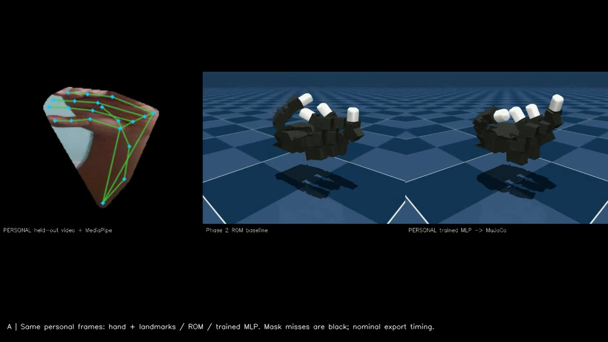
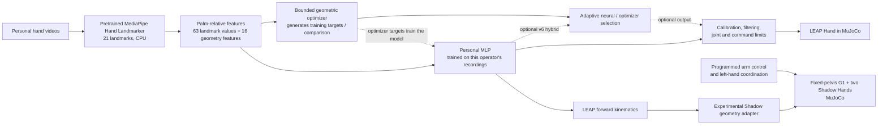

# JARVIS-Hand — Personalized Human-to-Humanoid Motion Retargeting

[](LICENSE)
[](https://www.python.org/downloads/release/python-3119/)
[](#installation)

A CPU-compatible robotics project that uses personally recorded hand movements to train a compact retargeter for a simulated LEAP Hand, then investigates geometry transfer to a fixed-base Unitree G1 with two Shadow Hands.

**[▶ Watch the demonstration](https://drive.google.com/file/d/19wrV4-QulbFKnXYRngHCNEGr0R_2hMjI/view?usp=sharing)** · [GitHub profile: Mr-strom](https://github.com/Mr-strom)



*Frame from the linked demonstration: privacy-masked personal hand landmarks alongside the actual LEAP simulation. The full video also contains portions where the operator is visible.*

### Verified highlights

- **34 personal recordings**, **3,672 valid detections** from 3,905 sampled frames, grouped by whole recording for train/validation/test.
- A **28,816-parameter personalized MLP** that runs on CPU and improves LEAP geometric correspondence error over the ROM baseline.
- Actual webcam-to-LEAP mirroring and personal-recording replay in MuJoCo.
- Fixed-pelvis G1 simulation with two articulated Shadow Hands; cross-embodiment neural transfer did **not** outperform simpler mapping.
- Sustained valid grasp outcomes remain **0/5** in the reported LEAP recovery trials.

## Table of contents

- [Overview](#overview)
- [Key features](#key-features)
- [System architecture](#system-architecture)
- [Repository structure](#repository-structure)
- [Installation](#installation)
- [Dataset preparation](#dataset-preparation)
- [Usage guide](#usage-guide)
- [Configuration](#configuration)
- [Results and benchmarks](#results-and-benchmarks)
- [Our development journey: what worked, what failed, and what we learned](#our-development-journey-what-worked-what-failed-and-what-we-learned)
- [Assumptions and limitations](#assumptions-and-limitations)
- [Contributing, license, and acknowledgements](#contributing-license-and-acknowledgements)
- [Appendix](#appendix)

## Overview

Human finger motion does not map directly to a robot hand: link lengths, joint axes, thumb opposition, coupled joints, and actuator limits differ. Webcam landmarks also have uncertain depth, can disappear under occlusion, and depend on handedness and camera orientation. JARVIS-Hand asks how much personally demonstrated finger motion can be transferred to a dexterous simulated hand with a small, reproducible CPU pipeline.

The primary path is:

**Human video → MediaPipe 21 hand landmarks → palm-relative motion features → personalized neural retargeter → bounded actuator commands → MuJoCo LEAP physics.**

The separate humanoid experiment uses LEAP forward-kinematic geometry to adapt the learned right-hand motion to a Shadow Hand on a full G1 model. That adapter is analytical and experimental. The pelvis is fixed; arm movement and left-hand coordination are scripted. It is not a learned bimanual policy.

This project is **not** an RL-fine-tuned vision-language-action model. It contains no PPO/SAC/AWAC training, VLA checkpoint, LLM planner, autonomous manipulation policy, or locomotion controller.

## Key features

- Personal video ingestion with timestamps, frame validity, source provenance, and recording-level splits.
- MediaPipe Hands landmark extraction using the upstream pretrained hand-landmark model.
- Personally trained 28,816-parameter MLP mapping 79 motion features to 16 LEAP actuator targets.
- LEAP Hand neural replay and live webcam control with calibration, temporal filtering, bounded commands, and tracking-loss fallback.
- ROM and bounded geometric optimization baselines with reproducible numerical evaluation.
- Optional **v6 adaptive precision** experiment. It can select between neural and optimization outputs; it remains optional and did not improve physical replay accuracy.
- Fixed-base Unitree G1 with two articulated Shadow Hands; right-hand embodiment transfer is experimental and the left-hand coordination is scripted.
- MuJoCo simulation checks for actuator limits, numerical warnings, physical state, and contact diagnostics.

## System architecture



**Component provenance:** MediaPipe is pretrained upstream perception; the MLP is the project's personally trained machine-learning component; ROM and the geometric optimizer are analytic/optimization methods; command filtering and G1 arm/left-hand coordination are programmed control; LEAP and G1/Shadow run in MuJoCo. Shadow transfer is experimental. The two robot hands are articulated, but the left-hand motion is scripted, not learned.

## Repository structure

```text
.
├── docs/                 Reproduction, demo, historical, privacy and license notes
│   └── images/           README demonstration screenshot
├── experiments/          Retained Dex5 feasibility attempt and diagnostics
├── learning/             Personal model runtime and adapted differentiable LEAP FK
├── licenses/             Upstream model and adapted-code notices
├── release_artifacts/    Approved representative personal sample, landmarks,
│                         calibration and inference checkpoint
├── reports/              Dataset, training, evaluation, stability and smoke results
├── scripts/              Asset retrieval, preprocessing support and evaluation tools
├── tests/                Phase, model, humanoid, manipulation and validation tests
├── v6/                   Optional adaptive-precision controller and its evaluations
├── live_mirror.py        Geometry/ROM webcam mirror
├── neural_live.py        Personalized LEAP webcam controller
├── simulate.py           Standalone LEAP actuator simulation
├── replay_personal.py    Personal recording replay
├── cross_embodiment.py   ROM/MLP-to-Shadow evaluation
└── humanoid_control.py  Fixed-base G1 simulation / scripted arm demo
```

Robot models and the MediaPipe task file are retrieved by pinned, checksum-checked scripts; they are not vendored in the repository. `release_artifacts/` holds the approved small sample set, not the complete private dataset. Local restoration writes data to ignored `private/`. `v7/` is a rejected local experiment and is not part of the public repository.

## Installation

Verified platform: Windows 11, CPython **3.11.9 x64**, CPU-compatible MuJoCo. No CUDA, paid cloud service, or global Python modification is required. The verified installed versions include MuJoCo 3.11.0, MediaPipe 0.10.32, OpenCV Contrib 4.12.0.88, NumPy 2.2.6, SciPy 1.15.3, PyTorch 2.5.1+cpu, and pytest 8.4.2. Hashed lock files are authoritative.

From PowerShell:

```powershell
git clone https://github.com/Mr-strom/JARVIS_HAND_CAPTURE.git
Set-Location JARVIS_HAND_CAPTURE
py -3.11 -m venv .venv
& '.\.venv\Scripts\python.exe' -c "import sys; assert sys.version_info[:3] == (3,11,9), sys.version"
& '.\.venv\Scripts\python.exe' -m pip install --require-hashes --only-binary=:all: -r requirements.lock
& '.\.venv\Scripts\python.exe' -m pip install --require-hashes -r requirements-learning.lock
& '.\.venv\Scripts\python.exe' scripts\fetch_leap.py
& '.\.venv\Scripts\python.exe' scripts\fetch_g1_shadow.py
& '.\.venv\Scripts\python.exe' scripts\fetch_hand_landmarker.py
& '.\.venv\Scripts\python.exe' -m pip check
```

Model retrieval is pinned and checksum-checked. A clean-source extraction was smoke-tested using the already installed environment and cached assets; a fresh network installation of every wheel and asset was **not** repeated as part of that check. Run the following after restoring the published sample as described below.

## Dataset preparation

The operator recorded **34 videos** with varied finger flexion, open/closed hand shapes, pinches, and object-handling gestures. Filenames were not treated as gesture labels. The existing pipeline sampled **3,905 frames** and retained **3,672 valid hand detections**. Recordings were split as whole clips: **24 train / 5 validation / 5 test**, with 2,280 / 471 / 921 valid observations. Recordings can share capture sessions and background; this is held-out-recording evaluation, not held-out-person or guaranteed independent-session generalization.

The model input has **79 features**: 63 canonical landmark coordinates and 16 hand-geometry features. Inputs are palm-relative and normalized using training-only statistics. Robot joint targets were generated by bounded LEAP geometric optimization and verified against MuJoCo forward kinematics; they are not ground-truth robot labels measured from the human video. The MLP regresses those optimization-generated targets.

Training used AdamW with seed 42 and early stopping. The best validation checkpoint was epoch 77 (validation MSE 0.039865; training MSE 0.013664); training ended at epoch 113. The original successful checkpoint is reused in the release and was not retrained for these final comparisons.

The public sample is a small, privacy-reviewed representative example and matching derived landmarks, not all 34 source videos. It demonstrates the input format, trained inference, and replay. It cannot reproduce the full training run. Raw source recordings remain private. To process your own videos, place supported files in a project-local folder and run:

```powershell
& '.\.venv\Scripts\python.exe' personal_data.py --source data\personal\raw
```

The command preserves source files and records derived frames/features and provenance in the configured local data tree. Review the generated manifest before training or sharing any derived personal data.

## Usage guide

### 1. Restore the approved sample and run its replay

```powershell
& '.\.venv\Scripts\python.exe' scripts\restore_release_artifacts.py
& '.\.venv\Scripts\python.exe' scripts\replay_approved_sample.py --viewer
& '.\.venv\Scripts\python.exe' scripts\release_sample_smoke.py
```

The restore step copies only the repository sample into ignored local paths. Missing files fail explicitly; there is no synthetic personal-data fallback.

### 2. Train the personalized neural retargeter

Full training requires all 34 original personal recordings and a valid calibration. This is not reproducible from the small public sample alone.

```powershell
& '.\.venv\Scripts\python.exe' live_mirror.py
# Calibrate in the application, then quit with Q/Esc.
& '.\.venv\Scripts\python.exe' personal_data.py --source data\personal\raw
& '.\.venv\Scripts\python.exe' train_personal.py
```

The existing trained checkpoint is provided for inference; do not retrain to reproduce the reported inference demo.

### 3. Run LEAP neural replay and live control

```powershell
& '.\.venv\Scripts\python.exe' neural_live.py --hand any --seconds 30
& '.\.venv\Scripts\python.exe' replay_personal.py
```

`neural_live.py` uses the webcam and restored personal checkpoint/calibration. `--hand any` is useful when only one hand is visible; the default is right-hand selection. Press Q/Esc to exit. Total physical motion-to-display latency has not been measured.

`replay_personal.py` replays the full private recording cache and is not a public-sample command. It requires the corresponding local `private/learning/predictions.npz` cache and source-video paths; it does not silently substitute synthetic motion. Use the approved sample tools below for a clean public checkout.

### 4. Evaluate ROM, neural, and optimization approaches

```powershell
& '.\.venv\Scripts\python.exe' scripts\compare_approved_sample.py
& '.\.venv\Scripts\python.exe' scripts\release_leap_metrics_smoke.py
& '.\.venv\Scripts\python.exe' cross_embodiment.py --dataset private\final\heldout_landmarks
```

The first two run sample-level checks. Reproducing full published cross-embodiment and held-out metrics requires the private five-clip derived evaluation pack; full original video is not required for that cached-feature comparison.

### 5. Run the optional v6 adaptive precision controller

Neural remains the default. `optimizer` and `hybrid` are explicit optional comparisons:

```powershell
& '.\.venv\Scripts\python.exe' -m v6.launch --controller neural --hand any --seconds 30
& '.\.venv\Scripts\python.exe' -m v6.launch --controller optimizer --seconds 30
& '.\.venv\Scripts\python.exe' -m v6.launch --controller hybrid --seconds 30
```

The trained checkpoint and calibration are needed. See [`v6/INNOVATION_V6_REPORT.md`](v6/INNOVATION_V6_REPORT.md) and [`v6/MERGE_DECISION.md`](v6/MERGE_DECISION.md) for the optional mode's timing and physical-accuracy tradeoffs.

### 6. Launch the fixed-base G1 / Shadow Hand humanoid

```powershell
& '.\.venv\Scripts\python.exe' humanoid_control.py --viewer --seconds 30
```

This demonstrates the existing physically simulated arm/hand actuators. The example's arm targets are scripted; the pelvis is fixed. Personal right-hand replay through the experimental Shadow adapter is available locally when its prediction cache is present:

```powershell
& '.\.venv\Scripts\python.exe' humanoid_personal_replay.py
```

That optional replay is not included as a one-command public-sample reproduction because its original prediction cache is private.

### 7. Run the public-sample tests

```powershell
& '.\.venv\Scripts\python.exe' -m pytest -q -rs tests v6/test_adaptive.py v6/test_selection.py
```

With the approved sample restored, the documented suite has **35 passing tests**. Before restoration, private-input cases are expected to skip. The clean-source validation reused the already installed Python environment and local robot assets; it did not re-download wheels from a clean network environment.

## Configuration

- **Robot assets:** LEAP Hand model and G1/Shadow composite model are fetched at the revisions/checksums in `reports/leap_asset_manifest.json`, `reports/g1_asset_manifest.json`, and the downloader scripts. Do not replace these silently.
- **Hand selection:** `neural_live.py --hand right|left|any`; the installed camera path defaults to right. G1 currently uses the right Shadow Hand for personal transfer; the left hand is scripted.
- **Calibration:** `private/calibration.json` is restored from the approved sample or generated by the live calibration process. ROM normalization is user/session dependent.
- **Controller:** v5 neural is the normal/default path. v6 exposes `neural`, `optimizer`, and `hybrid` selection through `v6.launch`; only neural is the verified default.
- **Filtering and bounds:** live LEAP commands use temporal smoothing, range enforcement, and rate limiting. v6 additionally bounds command velocity/acceleration and uses a bounded optimizer with fallback. These are command constraints, not guarantees on every physical servo derivative.
- **Evaluation inputs:** sample smoke uses `release_artifacts/`; full held-out tests use the cached private five-recording feature set and original timestamps. Do not substitute the public sample while claiming full held-out reproduction.
- **Simulation:** native MuJoCo stepping is CPU-based; OpenGL is used for rendering. Vulkan is not required.

## Results and benchmarks

### LEAP held-out geometric correspondence

The original evaluation used five held-out recordings (921 valid observations). Errors are geometry-derived correspondence proxies under the stated human-to-robot proportions, not external motion-capture ground truth.

| Controller | Fingertip error ↓ | Pinch error ↓ |
|---|---:|---:|
| ROM baseline | 61.32 mm | 41.12 mm |
| Personalized MLP | 32.96 mm | 16.68 mm |
| Original geometric optimizer / teacher | **27.83 mm** | **8.93 mm** |

The MLP reduces the selected fingertip proxy error versus ROM, while the optimizer remains more accurate. The personal model's CPU forward pass was measured at approximately **0.085 ms**; this is model inference time, not end-to-end camera-to-robot latency.

### Personal MLP warm-start ablation

| Optimizer initialization | Fingertip error ↓ | Pinch error ↓ | Samples / evaluations |
|---|---:|---:|---:|
| ROM initialization | 29.975 mm | 13.555 mm | 80 / 4 |
| Personal MLP initialization | **23.365 mm** | **10.459 mm** | 80 / 4 |

This is a bounded solver validation ablation on validation observations. One neural-initialized run timed out. It shows the learned model contributed a useful optimizer initialization on this protocol; it is not independent new-user generalization.

### v6 accepted-subset tradeoff

These numbers come from v6's shared accepted subset of **866 observations**. They must not be conflated with the original all-921 LEAP evaluation above.

| Method | Raw fingertip geometry ↓ | Physical replay fingertip error ↓ |
|---|---:|---:|
| Neural v6 mapping | 31.11 mm | 52.52 mm |
| Hybrid v6 | 27.28 mm | 50.10 mm |
| Optimizer | **22.06 mm** | 47.61 mm |

The raw-target column uses the v6 shared accepted subset of 866 observations; physical replay includes all 921 original valid observations. The separately measured v5 filtered neural reference had 49.93 mm physical error, so hybrid at 50.10 mm **did not improve physical replay**. The optimizer remains the accuracy leader. During the attended comparison the operator reported no obvious live improvement. v6 is therefore optional, not the default.

### G1 / Shadow and physical checks

| Shadow pathway | Normalized fingertip error ↓ | Direction cosine ↑ | Normalized pinch error ↓ |
|---|---:|---:|---:|
| Direct ROM | 0.918 | 0.763 | 0.496 |
| ROM → LEAP geometry → Shadow | **0.895** | **0.764** | 0.550 |
| Personal MLP → LEAP geometry → Shadow | 0.944 | 0.738 | 0.544 |

Errors are normalized by each hand's own palm-width scale; these are not uncalibrated millimetre comparisons. Neural transfer did not improve Shadow alignment. The G1 simulation is fixed-pelvis, with scripted arm targets and left-hand coordination. **50/50 tested arm/hand actuator channels responded physically** in simulation. A 60-second stability run had zero numerical warnings; small soft-limit excursions are disclosed in the detailed report. Sustained valid grasp holds remain **0/5** for the LEAP recovery benchmark, and prior single/assisted G1 attempts were also 0/5.

### Live operation boundaries

The earlier webcam runs measured about **7.49–10.31 unique captured FPS**, approximately **28 robot/display updates per second**, and **19.69–21.10 ms** mean MediaPipe processing time. The approximately 51 ms figure is software read-complete-to-render processing and excludes exposure/camera buffering, display scanout, and settling; full physical motion-to-display latency remains unverified. The later attended neural/hybrid run measured 8.62/7.49 captured FPS and 54.24/59.26 ms software delay in unmatched gesture/exposure conditions. It is not a paired live-accuracy experiment.

Detailed protocols, numerical definitions, grouped results, stability evidence, and limitations are in [the final integration report](FINAL_INTEGRATION_REPORT.md), [final submission report](FINAL_SUBMISSION_REPORT.md), and [`v6/INNOVATION_V6_REPORT.md`](v6/INNOVATION_V6_REPORT.md).

## Our Development Journey: What Worked, What Failed, and What We Learned

The work progressed from a basic physics proof to personal-data retargeting and then to measured embodiment experiments. We kept unsuccessful results rather than redefining success after a failed test.

| Phase | Challenge / hypothesis | Experiment and observed result | Lesson |
|---|---|---|---|
| 1 — model selection | The preferred Unitree Dex5 through somehand might be usable as the first hand model. | The core API loaded and exposed 20 actuators, but the unmodified asset produced a BADQACC failure, extreme velocity, and about 24.7 mm initial penetration. A tuned six-second run stabilized but retained penetration and only 19/20 moving joints. We rejected it and validated the right LEAP Hand instead. | A finite state or attractive render does not establish stable/contact-valid physics. Preserve upstream physics and switch models when acceptance criteria fail. |
| 2 — live mirror | Webcam landmarks can drive a dexterous hand continuously. | Built MediaPipe-to-LEAP geometry mirroring with calibration, named joint mapping, filtering, limits, and tracking-loss recovery. Diagnosed the “step 13534 reset” as a viewer reset misclassified by a guard; numerical faults remain errors. Live hand tracking visibly moved the real MuJoCo actuators. | Separate viewer reset events from physics instability; report capture rate and software latency accurately. |
| 3 — personal learning | A small model trained from this operator's videos can improve on a generic ROM mapping. | Processed 34 recordings and trained the 28,816-parameter MLP on geometry-optimizer targets. On held-out clips, fingertip error was 32.96 mm versus 61.32 mm for ROM; the optimizer teacher was still more accurate at 27.83 mm. | Personal data helps the chosen correspondence objective; generated targets and one operator do not prove external-ground-truth accuracy or user generalization. |
| 4 — grasping | Better finger closure and contact feedback might yield a stable object hold. | Repeated physical LEAP and G1 trials included contact/force telemetry and bounded recovery controls. Valid sustained outcomes stayed 0/5. | Finger closure and transient contact/lift are not grasp success. Keep the original physical hold criterion and stop when bounded recovery fails. |
| 5 — G1 / Shadow transfer | LEAP-learned geometry might carry to different robot anatomy. | Integrated a fixed-pelvis G1 with two Shadow Hands and tested direct ROM and LEAP-geometry adapters. The neural pathway's normalized Shadow fingertip error was 0.944 versus 0.918 direct ROM and 0.895 ROM-through-LEAP. Left-hand coordination and arm targets were scripted. | A robot moving in an animation does not show embodiment generalization. Joint names, frames, coupling, and geometry matter. |
| 6 — adaptive precision | Choosing between the fast MLP and a geometric optimizer could trade compute for precision. | On the v6 accepted subset, raw fingertip proxy improved from 31.11 mm neural to 27.28 mm hybrid; optimizer was 22.06 mm. Physical replay was 50.10 mm hybrid versus 49.93 mm neural-filter reference. Live comparison showed no obvious operator-visible improvement. | Better target geometry did not translate to better executed motion. Keep hybrid optional and do not claim physical improvement. |
| 7 — physics-aware compensation | MuJoCo state feedback might reduce the gap between desired and executed hand motion. | Instrumented target, actual joint state, dynamics, and replay; tested bounded physics-aware correction against the original baseline. It did not improve physical fingertip accuracy and was rejected; no release default was changed. | Additional control complexity is not justified without a measured physical benefit. |

A later guided-pinch diagnostic application and recording investigated where pinch correspondence could fail. It did not establish a new benchmark improvement or justify changing the released controller. The demonstration includes a guided session, but the experiment remains an investigation rather than a validated correction.

Assumptions were made explicit: the human/robot correspondence comes from geometry and a bounded optimizer, the operator is the only training person, and the G1 task uses fixed-base simulation. Where an approach did not outperform the baseline—Dex5 acceptance, stable grasping, Shadow transfer, v6 physical replay, and v7 physical correction—we retained that outcome and rejected claims of success.

## Assumptions and limitations

- Monocular MediaPipe landmarks are approximate; depth and occluded joints are uncertain. Pinch distance is not calibrated world-space ground truth.
- Robot targets are geometry/optimization-generated, not synchronized measured LEAP joint labels recorded while a human wore a robot hand.
- Training uses one operator and 34 videos. Held-out clips do not demonstrate new-user generalization; the full training videos remain private.
- LEAP has four independently modeled digits and does not reproduce an independent little finger. Some thumb opposition mapping is heuristic.
- The G1 pelvis is fixed. There is no learned balance, dynamic locomotion, or full-body policy.
- The left Shadow Hand and G1 arm targets are scripted; no learned bimanual policy exists.
- Shadow geometry transfer is experimental and neural transfer did not beat simpler baselines.
- Stable physical grasping is unsuccessful: 0/5 valid LEAP holds in the reported recovery benchmark; G1 grasp attempts also remain unsuccessful.
- Webcam capture measured 7–10 unique FPS in earlier runs. The roughly 51–59 ms software processing measurements omit camera exposure/buffering and physical settling; actual motion-to-display latency is unverified.
- v6 hybrid improved a geometry proxy on its own accepted subset but slightly worsened physical replay versus its neural reference; operator saw no obvious live improvement.
- The approved representative release sample is not the complete 34-recording training set. Full retraining and the full held-out pack are not publicly reproducible from that sample.
- There is no learned VLA, RL policy, LLM reasoning, autonomous object manipulation, real-world robot actuation, or validated sim-to-real transfer.

## Contributing, license, and acknowledgements

Original project code is under the [MIT License](LICENSE), copyright 2026 Mr-strom. This applies to original code only. Personal videos, landmarks, calibration, and the trained checkpoint are personal artifacts; public access to the approved representative set does not itself grant a general downstream reuse license.

Retain upstream notices and licenses. In particular, the repository includes adapted LEAP FK from handrobot under its MIT notice, the LEAP/Menagerie model notice, MediaPipe Apache-2.0 package/model attribution, and the composite Unitree/Shadow model notice. Robot assets are retrieved separately at pinned revisions. See [`THIRD_PARTY_NOTICES.md`](THIRD_PARTY_NOTICES.md), [`docs/RELEASE_LICENSE_REVIEW.md`](docs/RELEASE_LICENSE_REVIEW.md), and the `licenses/` directory. The original project does not claim ownership of MuJoCo, MediaPipe, LEAP, Unitree, Shadow, or adapted handrobot code.

## Appendix

- [Final integration report](FINAL_INTEGRATION_REPORT.md) — v5 default/v6 optional integration, attended measurements, tests, and release boundary.
- [Final submission report](FINAL_SUBMISSION_REPORT.md) — full protocols, grouped evaluation, grasp failures, privacy, and reproducibility.
- [Development history](docs/DEVELOPMENT_JOURNEY.md) — chronological experiment record and failure lessons.
- [Learning and manipulation details](LEARNING_AND_MANIPULATION.md) — training targets, optimizer, task protocol, and physical results.
- [v6 adaptive precision report](v6/INNOVATION_V6_REPORT.md) and [merge decision](v6/MERGE_DECISION.md).
- [Public reproduction boundary](docs/PUBLIC_REPRODUCTION.md) and [demonstration notes](docs/DEMONSTRATION.md).
- [Phase 1](PHASE1_REPORT.md), [Phase 2](PHASE2_REPORT.md), [humanoid v4](HUMANOID_V4_REPORT.md), and [research reuse/attribution](RESEARCH_REUSE.md).
- [Results table](reports/method_comparison.csv), [personal model metrics](reports/personal_model_results.json), [Shadow results](reports/cross_embodiment_results.json), and [`v6/summary.json`](v6/summary.json).
- Additional verified plots: [`reports/final_evaluation.png`](reports/final_evaluation.png) and [`v6/before_after_evaluation.png`](v6/before_after_evaluation.png).
- Watch the [full demonstration](https://drive.google.com/file/d/19wrV4-QulbFKnXYRngHCNEGr0R_2hMjI/view?usp=sharing). The shared Drive file was opened and played in a signed-out browser session; no account sign-in was needed.

The shared video contains visible operator footage in some sections. The README screenshot is an actual frame where the hand pane is masked against black and no face or room is visible. The screenshot does not anonymize the entire video.
