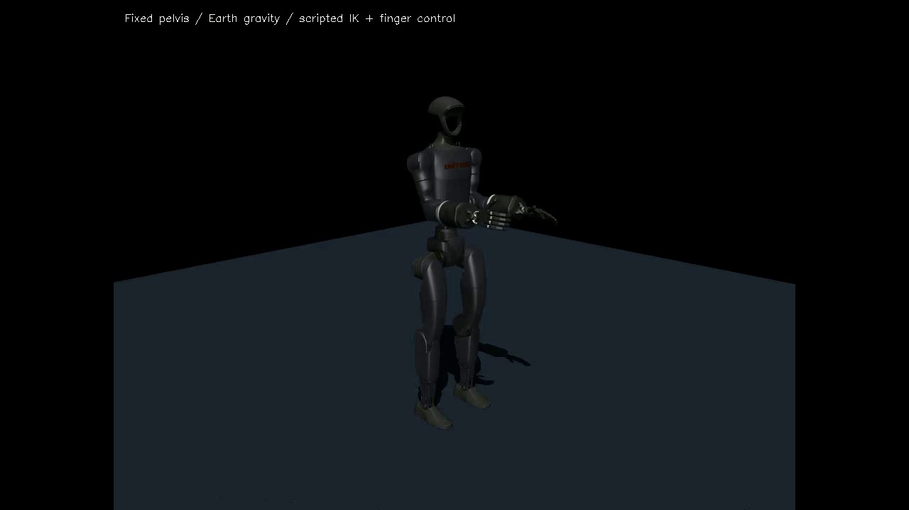

# JARVIS-Hand — Personalized Human-to-Humanoid Motion Retargeting

A CPU-compatible robotics system using personally recorded human hand movements to train a neural retargeter, drive a simulated LEAP Hand, and investigate transfer to a full fixed-base G1 humanoid with two Shadow Hands.

**Main demo:** a90-second MP4 is prepared locally. The owner will upload the approved video manually; a verified public Drive URL is pending. [Video guide](docs/DEMONSTRATION.md).



## Three contributions

1. Personal learning:34 recordings,3,672 usable detections and a28,816-parameter CPU MLP, evaluated using whole held-out recordings.
2. Precision tradeoffs: neural improves over ROM; optimization remains more accurate. Personal MLP initialization improves a bounded optimizer. Optional v6 selects neural or optimization with safe recovery.
3. Honest embodiment evaluation: controlled G1 arms and two articulated Shadow Hands, analytical transfer, scripted left-hand coordination and documented negative transfer/grasp outcomes.

## Quickstart

Windows11, CPython3.11.9 x64, OpenGL driver. Run from the repository root. No CUDA required. The repository is intended for public release.

```powershell
git clone https://github.com/Mr-strom/JARVIS_HAND_CAPTURE.git
Set-Location JARVIS_HAND_CAPTURE
py -3.11 -m venv .venv
& '.\.venv\Scripts\python.exe' -c "import sys; assert sys.version_info[:3] == (3,11,9), sys.version"
& '.\.venv\Scripts\python.exe' -m pip install --require-hashes --only-binary=:all: -r requirements.lock
& '.\.venv\Scripts\python.exe' -m pip install --require-hashes -r requirements-learning.lock
& '.\.venv\Scripts\python.exe' scripts\fetch_leap.py
& '.\.venv\Scripts\python.exe' scripts\fetch_g1_shadow.py
& '.\.venv\Scripts\python.exe' scripts\fetch_hand_landmarker.py
& '.\.venv\Scripts\python.exe' -m pip check
& '.\.venv\Scripts\python.exe' simulate.py --viewer --seconds 10
```

Asset downloads are pinned and checksum-checked. Clean-copy validation reused the existing pinned environment and cached assets; a new network installation was not repeated.

## Personal sample and controllers

Four proposed files under `release_artifacts/` provide sample RGB, matching landmarks, checkpoint and calibration. The owner approved this four-file set for the repository. Restore it locally before running inference:

```powershell
& '.\.venv\Scripts\python.exe' scripts\restore_release_artifacts.py
& '.\.venv\Scripts\python.exe' scripts\replay_approved_sample.py --viewer
& '.\.venv\Scripts\python.exe' scripts\release_sample_smoke.py
& '.\.venv\Scripts\python.exe' scripts\compare_approved_sample.py
& '.\.venv\Scripts\python.exe' -m v6.launch --controller neural --hand any --seconds 30
& '.\.venv\Scripts\python.exe' -m v6.launch --controller optimizer --seconds 30
& '.\.venv\Scripts\python.exe' -m v6.launch --controller hybrid --seconds 30
& '.\.venv\Scripts\python.exe' humanoid_control.py --viewer --seconds 10
& '.\.venv\Scripts\python.exe' -m pytest -q -rs tests v6/test_adaptive.py v6/test_selection.py
```

Neural is the unchanged v5 default; hybrid is optional. Show only one hand with `--hand any`. Missing personal files raise errors; there is no synthetic replacement. Before restoration,30 tests pass and five skip (two original private-input checks and three v6 checks); after restoration35 pass. V7 is excluded.

Sample comparison executes ROM, neural, optimizer and hybrid on that sample. It does not reproduce full held-out results. [Reproduction boundary](docs/PUBLIC_REPRODUCTION.md).

## Architecture and learning

```text
Personal videos -> CPU MediaPipe -> canonical landmarks + joint features
 -> personal LEAP MLP -> bounded/filter commands -> MuJoCo physics
                         + optional v6 optimization
LEAP FK geometry -> experimental Shadow adapter -> fixed-pelvis G1
                                                  + scripted arms/left hand
```

24/5/5 recordings form train/validation/test, with2,280/471/921 usable observations. Original timestamps, invalid frames, hashes and provenance are retained. Normalization uses training data only. The79->128->128->16 MLP regresses optimization-generated joint targets through verified FK, using AdamW and early stopping. Best epoch77; training stopped at113. One sample cannot reproduce training on34 private recordings. [Training details](LEARNING_AND_MANIPULATION.md).

## Main results

Original five-clip/921-observation LEAP geometric proxy evaluation:

| Method | Fingertip error | Pinch error |
|---|---:|---:|
| ROM |61.32mm|41.12mm|
| Personal MLP |32.96mm|16.68mm|
| Optimizer teacher |**27.83mm**|**8.93mm**|

Neural fingertip error is46.2% lower than ROM. These are proportion-adjusted targets, not external ground truth. A separate80-pose validation ablation gave ROM/MLP-initialized optimizer errors29.98/23.36mm. No new-user generalization is established.

Optional v6 uses a shared866-observation accepted subset: neural/hybrid raw tip error31.11/27.28mm, optimizer22.06mm. Physical replay slightly worsened49.93->50.10mm versus the original neural filter. Command acceleration is bounded at30rad/s², not actual physical acceleration. Attended neural/hybrid software delay was54.24/59.26ms, excluding exposure/buffering/settling. The operator reported no obvious live improvement. [v6 details](v6/INNOVATION_V6_REPORT.md).

The G1 pelvis is fixed;50/50 tested arm/hand channels responded. A60s run had zero numerical warnings and small disclosed soft-limit excursions. Normalized Shadow tip errors: direct ROM0.918, ROM through LEAP0.895, personal MLP through LEAP0.944. Neural transfer did not outperform simpler mapping. Left-hand behavior is scripted. Sustained LEAP/G1 grasp holds remained0/5. No autonomous grasping, learned bimanual policy, VLA, LLM reasoning, locomotion or dynamic balance is claimed.

## Licenses and acknowledgements

Original code is released under the [MIT License](LICENSE), copyright 2026 Mr-strom. Public access to the four personal artifacts is approved; downstream reuse terms require an explicit grant. Retain MIT handrobot FK/LEAP notices, Apache-2.0 MediaPipe notices and the Unitree/Shadow composite notice. Assets are fetched separately. [Notices](THIRD_PARTY_NOTICES.md) · [License inventory](docs/RELEASE_LICENSE_REVIEW.md).
