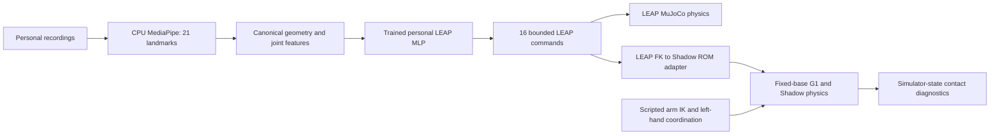

> **v5 RC1: LOCAL APPROVAL CANDIDATE — NOT CLEARED FOR PUBLICATION.** No original-code license has been applied.
> Start with [installation and demo links](docs/RELEASE_QUICKSTART.md), [licensing review](docs/RELEASE_LICENSE_REVIEW.md) and `RELEASE_APPROVAL_REQUIRED.json`.
> Personal files in `release_artifacts/` are proposed release copies; all approval flags remain false. Raw recordings are excluded.

# JARVIS-Hand — personalized learning across robot hands

**A small CPU neural network learns one operator's recorded hand movements for LEAP. We then test whether that learned geometry transfers to Shadow Hands on a fixed-base G1 humanoid.**

The strongest result is personalized LEAP retargeting: **46.2% lower held-out fingertip geometry-target error than ROM mapping**. Transfer to Shadow is an executed, evaluated experiment: the neural pathway **does not improve Shadow fingertip alignment**. Physical grasp attempts remain unsuccessful. This submission reports those limits alongside the working demonstrations.

## 1. The problem

Make personally recorded human motion control a simulated robot hand on an ordinary Windows laptop, and evaluate what survives a change of robot anatomy. No CUDA, paid cloud, large-model training or third-party demonstration trajectories are required.

## 2. Why transfer is difficult

Human, LEAP and Shadow hands have different link lengths, axes, thumb placement and joint coupling. LEAP has four digits and sixteen actuators; Shadow adds a little finger, different thumb joints and tendon-coupled distal joints. Copying angle arrays cannot preserve their geometry. Monocular landmarks also have uncertain depth and handedness. We distinguish command geometry, physical tracking and successful manipulation.

## 3. Personally collected data

The operator recorded **34 videos**. CPU MediaPipe extraction produced **3,905 sampled frames / 3,672 valid detections (94.03%)**. Original timestamps, invalid observations, tracking labels and source hashes are retained. Geometry categories are estimates; arbitrary filenames are not gesture labels. Recordings contain finger flexion, open/closed shapes and pinch/object-handling motions. Human object interaction is not a label for successful robot manipulation.

Whole recordings form **24 training / 5 validation / 5 test clips**, with **2,280 / 471 / 921** valid frames. A conservative near-duplicate screen groups suspected matches before splitting. Clips can share a person, room and session: this is held-out-recording evaluation, not new-person or independently held-out-session generalization. See [collection and learning details](LEARNING_AND_MANIPULATION.md).

Raw videos are private and visibly include the operator and room. A proposed silent, hand-masked sample, timestamped landmarks, checkpoint and portable held-out landmark pack are prepared locally. **Their publication is awaiting approval.** One sample is insufficient to reproduce full training; all 34 private recordings are needed for that exact run.

## 4. Neural training methodology

The trained **79 → 128 → 128 → 16 MLP has 28,816 parameters**. Inputs are 63 canonical landmark coordinates and sixteen joint-geometry features. Output sigmoid values map into conservative LEAP ranges intersected with actual actuator limits.

Robot targets are generated by bounded optimization through differentiable LEAP FK, checked against MuJoCo to **1.45e-8 m maximum point difference** over twenty random poses. The teacher objective is fingertip MSE plus 0.25 times pinch-distance MSE. Human digit shape is proportion-adjusted to the robot chain and anchored at its base. These are geometry-derived targets, not measured robot joint labels from video.

The network regresses normalized teacher commands using AdamW, training-only input normalization, seed 42 and early stopping. Training stopped at epoch 113; best epoch 77 had train MSE **0.013664** and validation MSE **0.039865**. The original successful weights were reused without retraining for the final experiments. This is neural retargeting, not an autonomous manipulation or VLA policy.

## 5. Why cross-embodiment transfer matters

A reusable personal movement representation could reduce the need to train separately for every hand. We test that idea rather than inferring it from animation. Three pathways receive the **same five held-out recordings**:

1. Calibrated human features directly mapped into named Shadow ROM channels.
2. Phase 2 ROM commands → LEAP FK geometry → unchanged v4 Shadow adapter.
3. Personalized MLP commands → LEAP FK geometry → the same Shadow adapter.

No Shadow-specific training or test-set fitting is performed. The original analytical adapter remains experimental. The little finger stays neutral, and the left hand is not learned.

## 6. Technical architecture



The original webcam app preserves personal calibration, temporal filtering, rate limiting, input validation and tracking-loss fallback. Native MuJoCo runs on CPU; OpenGL renders the images. The G1 pelvis is anchored, so there is no balance or locomotion claim. Each arm has five actuators in this assembly; each Shadow Hand has twenty including wrist channels.

Ground-truth object pose, contact normals and forces drive the experimental task controller. A separate RGB segmentation benchmark is not used to claim real-world scene perception. There is no autonomous imitation policy, learned left-hand coordination, LLM or hidden object attachment.

## 7. Demonstration

Local final video: **`private/final/JARVIS_Hand_final_demo.mp4`**. It contains three genuine-output segments:

- **A:** personal footage/landmarks with baseline and trained LEAP physics, plus measured training/evaluation results.
- **B:** fixed-base G1 movement and synchronized personal/three-pathway Shadow comparison.
- **C:** actual object-contact attempts with forces, opposition and honest failure reporting.

Human panes are hand-masked and zoomed for privacy; missing mask detections appear black. Presentation frames are sampled at nominal export FPS, with timestamps where available; this is not a real-time camera-latency demonstration. Some missing-observation intervals are compressed. Model states come from executed simulations, not unrelated rendered footage. Separate original technical clips remain private. The video will be placed in a public `demo/` folder only after explicit release approval.

## 8. Baseline comparisons

**LEAP kinematic geometry targets** (archived trained-model evaluation; errors depend on the stated proportional correspondence, not external motion-capture truth):

| Method | Fingertip error | Pinch error | Command-limit violations |
|---|---:|---:|---:|
| ROM | 61.32 mm | 41.12 mm | 0 |
| Optimization teacher | 27.83 mm | 8.93 mm | 0 |
| Personal MLP | 32.96 mm | 16.68 mm | 0 |

**Shadow physical replay**, equal-weight means across five clips / 921 observations per method:

| Pathway | Tip error, palm widths ↓ | Direction cosine ↑ | Pinch error, palm widths ↓ | Tracking RMSE, actuator-range fraction ↓ |
|---|---:|---:|---:|---:|
| Direct ROM | 0.918 | 0.763 | 0.496 | 0.0655 |
| ROM → LEAP geometry → Shadow | 0.895 | 0.764 | 0.550 | 0.0307 |
| Personal MLP → LEAP geometry → Shadow | 0.944 | 0.738 | 0.544 | 0.0292 |

Human canonical axes are thumb-side x, palm-forward y and signed curl z. Shadow palm-local coordinates transform to `[x,z,-y]`. Both are centered at the mean index/middle/ring MCP and divided by their **own index/little MCP span** (Shadow span approximately 46.58 mm). Fingertip endpoints are MediaPipe tips and Shadow distal mesh-axis endpoint proxies. Direction uses base-to-tip cosine; pinch uses thumb-to-index/middle/ring distances. Units are dimensionless palm widths, not cross-robot millimetres.

Each pathway replays **97.014 simulated seconds** under original timestamps with the same causal zero-order hold and actuator rate limits. No object is present. Dynamic metrics use actual physics states. The separate kinematic reference assumes equal J1/J2 splitting of each coupled tendon; actual dynamic states do not assume that split. This offline comparison holds the previous input across invalid-frame gaps; it does not replace the original live tracking-loss controller.

All pathways had zero numerical warnings and zero command-limit violations. Physical soft-limit samples were nonzero: maximum excursions were **0.00948 / 0.000665 / 0.000617 rad**, respectively. Counted samples are joint-step events above 1e-6 rad, not independent failures. Maximum contact penetration stayed below **0.257 mm**. CSV, recording-level results, raw counts, kinematic metrics and latency definitions are in [cross-embodiment results](reports/cross_embodiment_results.json).

The MLP improved LEAP's chosen geometry targets but did not improve Shadow alignment through this adapter. Lower normalized actuator tracking error is not evidence of better human geometry. No general-purpose cross-embodiment learning claim is made.

## 9. Verified results

- Original visually verified ROM webcam mirror and trained personal-video LEAP replay preserved.
- Actual G1/Shadow actuator response: **50/50** tested arm/hand channels.
- Anchored G1: **60 s / 30,000 steps**, zero numerical warnings; measured headless **2.23× real time**, about 475 MiB process memory. Typical palm dynamic tracking error was about 3 cm.
- Extended automated suite: **25 tests pass** in the actual installed environment. The extracted public archive passed **23 tests with 2 expected private-artifact skips**, using the installed environment and locally verified model assets. A new package installation was not repeated.
- Existing camera measurements remain about **7–10 unique frames/s**, display **28 Hz**, MediaPipe **20–21 ms**. Approximately **51 ms** software frame-read-to-render delay excludes exposure/buffering, display scanout, filtering and settling. Total physical motion latency is unmeasured.
- New Shadow mapping timings cover already extracted world landmarks → bounded commands, including features and FK/MLP. They exclude camera, MediaPipe, physics and display. Exact measured values appear in the JSON/CSV; they are not physical end-to-end latency.

## 10. Failure analysis and future work

V4 identified poor opposing contacts, tracking error and excessive penetration in rejected humanoid scenarios. One final bounded controller configuration adds thumb prepositioning, physical wrist alignment, per-digit force feedback, 0.4 Nm motor torque ceilings, additional servo damping, opposing-contact dwell and a gradual lift. Geometry, mass, friction and collision rules remain unchanged; the original benchmark and controller are retained.

**Final recovery: 0/5 valid holds.** The success criterion remains lift ≥2 cm, at least two contacting digits, no table contact and speed <0.15 m/s continuously for two seconds. A transient maximum lift near 20.4 mm never met the hold criterion. Trials had no numerical warnings or observed joint excursions; maximum penetration was 1.80 mm. Opposing contacts remained sparse. High seed-impact contact-force peaks still occurred; lower motor torque is not a guarantee of low impact force.

Archived G1 trials remain **0/5 single and 0/5 assisted**, with seven deep-contact integrity rejections across ten attempts. Brief table-supported stabilization is not a grasp. We freeze manipulation as unsuccessful rather than weakening the criterion or adding attachments.

Next steps are Shadow-specific geometry optimization, better thumb correspondence and collision-aware pregrasp planning. Temporal prediction was not added: securing the reproducible core and final artifacts took priority. No retraining or speculative architecture replaced the working system.

Detailed protocol, results and privacy/release boundaries: [final report](FINAL_SUBMISSION_REPORT.md), [v4 report](HUMANOID_V4_REPORT.md), [original README](docs/README_V4_ARCHIVE.md).

## 11. Reproduction instructions

Tested on Windows 11 / Ryzen 7 6800HS / 16 GB RAM / Python **3.11.9 x64**. Verified primary versions: MuJoCo **3.11.0**, MediaPipe **0.10.32**, OpenCV Contrib **4.12.0.88**, NumPy **2.2.6**, SciPy **1.15.3**, PyTorch **2.5.1+cpu**, pytest **8.4.2**. Full hashed wheel versions are locked. Global Python is unchanged.

For a **fresh extracted project directory**, with Python 3.11.9 already available:

```powershell
# Run from repository root
py -3.11 -m venv .venv
& '.\.venv\Scripts\python.exe' -c "import sys; assert sys.version_info[:3] == (3,11,9), sys.version"
& '.\.venv\Scripts\python.exe' -m pip install --require-hashes --only-binary=:all: -r requirements.lock
& '.\.venv\Scripts\python.exe' -m pip install --require-hashes -r requirements-learning.lock
& '.\.venv\Scripts\python.exe' scripts\fetch_leap.py
& '.\.venv\Scripts\python.exe' scripts\fetch_g1_shadow.py
& '.\.venv\Scripts\python.exe' scripts\fetch_hand_landmarker.py
& '.\.venv\Scripts\python.exe' -m pip check
& '.\.venv\Scripts\python.exe' -m pytest -q tests
```

Keep the current working environment if already installed. Model download scripts pin revisions/checksums; do not replace model assets silently. No package installation was necessary for the final extension. Fetching requires internet only during setup.

**Existing environment: working demonstrations**

```powershell
& '.\.venv\Scripts\python.exe' live_mirror.py
& '.\.venv\Scripts\python.exe' humanoid_control.py --viewer --seconds 30
& '.\.venv\Scripts\python.exe' simulate.py --seconds 6 --render --output reproduced_leap
```

The first command uses the webcam (C calibrates, Q exits). The other two are clearly labeled scripted actuator/arm demonstrations.

**With the approved private reproduction bundle restored at its supplied paths:**

```powershell
& '.\.venv\Scripts\python.exe' neural_live.py
& '.\.venv\Scripts\python.exe' cross_embodiment.py --dataset private\final\heldout_landmarks
& '.\.venv\Scripts\python.exe' humanoid_personal_replay.py
& '.\.venv\Scripts\python.exe' final_grasp_recovery.py --render
```

The public source archive intentionally excludes weights, calibration and personal landmarks/videos until approval. The proposed private bundle restores `private/learning/personal_mlp.pt`, `private/calibration.json` and `private/final/heldout_landmarks/`; replay requiring all original RGB clips still requires those private clips. `humanoid_personal_replay.py` requires the full original prediction cache and is an optional local technical demo, not part of the minimum reproduction bundle.

**Full personal training, only with the complete original dataset:** run `live_mirror.py` and collect calibration first, then:

```powershell
& '.\.venv\Scripts\python.exe' personal_data.py --source data\personal\raw
& '.\.venv\Scripts\python.exe' train_personal.py
& '.\.venv\Scripts\python.exe' replay_personal.py
& '.\.venv\Scripts\python.exe' cross_embodiment.py --render
& '.\.venv\Scripts\python.exe' scripts\final_results.py
```

The small sample demonstrates provenance and file format; it cannot reproduce the reported 34-video training by itself. Caches avoid repeated extraction. Existing camera commands, Phase 2 regressions and original stability checks are preserved in the archived README.

**Attribution and publication:** see [third-party notices](THIRD_PARTY_NOTICES.md) and `licenses/`. LEAP/Menagerie, handrobot FK and the Unitree/Shadow composite model have separate notices and pinned revisions. Original project-code licensing must be confirmed by the owner before public release; no third-party rights are changed. Source/results, media and personal-data bundles are separate. No GitHub push, upload or publication has occurred.
